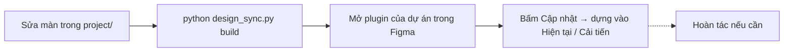

# Design Sync Toolkit cho Figma

Bộ công cụ giúp dev, BA và trợ lý AI dựng màn hình chỉnh sửa được trên Figma Desktop **chỉ bằng một nút bấm**. Màn được viết bằng code, build thành plugin Figma chạy **cục bộ 100%** (không server, không mạng). Yêu cầu: Git, Figma Desktop, Python 3.10+.

## Cách hoạt động



- Mỗi team **clone kit thành repo của mình**; màn và cấu hình (tên plugin, cỡ khung, khung đích) nằm trong `project/` và được commit chung.
- Plugin không ghi đè bản đã duyệt và phần designer tự chỉnh; tự nhận bố cục Section **Hiện tại / Cải tiến** có sẵn trong file Figma.

## Bắt đầu nhanh

```sh
git clone https://github.com/xuanntdev/figma-design-toolkit.git my-app-design
cd my-app-design
python design_sync.py init --name "Tên dự án"
python design_sync.py build
```

Trong Figma Desktop: **Plugins → Development → Import plugin from manifest…** → `project/dist/manifest.json`, mở plugin rồi bấm **Cập nhật**.

Đưa lên repo của team, cấu hình và bảng lệnh: xem [docs/setup.md](docs/setup.md).

## Tài liệu

- [Cài đặt, làm việc nhóm & cấu hình dự án](docs/setup.md)
- [Quy ước Hiện tại / Cải tiến & bảo vệ bản duyệt](docs/workflow.md)
- [Mẫu prompt cho AI (Cursor / Claude / Codex / AGY)](docs/ai-prompts.md)
- [Script mẫu chụp giao diện Web Sáng/Tối bằng Playwright](docs/capture-web.mjs)

[Thông báo giấy phép](LICENSE.upstream.txt)
