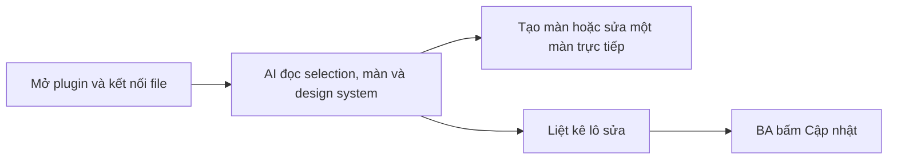

# Design Sync Toolkit cho Figma

Bộ công cụ cho BA, trợ lý AI và dev đọc thiết kế, dựng và sửa màn qua plugin được import từ manifest trong Figma Desktop. CLI kết nối tới plugin qua cầu nối `localhost` của mỗi checkout. Toolkit không gọi Figma REST API, không dùng Figma MCP và không yêu cầu access token Figma. Yêu cầu Git, Figma Desktop và Python 3.10+.

## Cách hoạt động



- Thiết kế đã lưu trong Figma là đầu vào cho yêu cầu tiếp theo. `pull` lưu bản đọc theo file đã ghép vào `project/figma-state/`.
- AI có thể thao tác trên page hoặc Section đang dùng và tái sử dụng component/style/token sẵn có. Page bị cấm ghi vẫn đọc được.
- Dự án dùng builder có thể giữ quy trình Hiện tại / Cải tiến, các preset lưới/Section và diff theo màn. `"bridge": null` giữ plugin ở chế độ offline. [Cấu hình builder](docs/workflow.md)

## Bắt đầu nhanh

Mỗi dự án clone kit thành repo thiết kế của chính dự án: đặt tên repo theo dự án và đặt tên plugin (`--name`) theo dự án.

```sh
git clone https://github.com/xuanntdev/figma-design-toolkit.git <dự-án>-design
cd <dự-án>-design
python design_sync.py init --name "Tên dự án"
python design_sync.py build
python design_sync.py doctor
```

Trong Figma Desktop, chọn **Plugins → Development → Import plugin from manifest…** và mở `project/dist/manifest.json`. Mở plugin ở đúng file thiết kế rồi bấm **Kết nối file**. Trợ lý AI tìm luồng qua [AGENTS.md](AGENTS.md).

Đưa lên repo của team, bảng cấu hình và bảng lệnh: xem [docs/setup.md](docs/setup.md).

## Cấu trúc repo

| Đường dẫn | Nội dung |
| --- | --- |
| `design_sync.py` | CLI cho setup, build và làm việc với Figma |
| `kit_core/` | Mã plugin, bridge, cấu hình và đọc thiết kế |
| `docs/` | Hướng dẫn cài đặt, tích hợp và sử dụng |
| `tests/`, `verify_release.py` | Ca kiểm và lệnh chạy toàn bộ |
| `capture/` | Công cụ nhập ảnh tham chiếu tùy chọn |

## Tài liệu

- [**Nguyên tắc thiết kế khi sinh màn** (component dùng chung là bắt buộc, token chuẩn Figma…)](docs/nguyen-tac.md)
- [Cài đặt, làm việc nhóm & cấu hình dự án](docs/setup.md)
- [CLI tạo màn, sửa selection và cập nhật hàng loạt](docs/figma-live.md)
- [Hai cách dùng điển hình, Hiện tại / Cải tiến & bảo vệ bản duyệt](docs/workflow.md)
- [Mẫu prompt cho AI (Cursor / Claude / Codex / AGY)](docs/ai-prompts.md)
- [Chụp web thành snapshot bằng Playwright (`capture/`, tuỳ chọn)](docs/capture.md)
- [Script mẫu chụp giao diện Web Sáng/Tối bằng Playwright](docs/capture-web.mjs)

[Thông báo giấy phép](LICENSE.upstream.txt)
